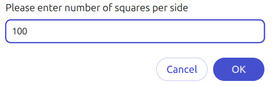
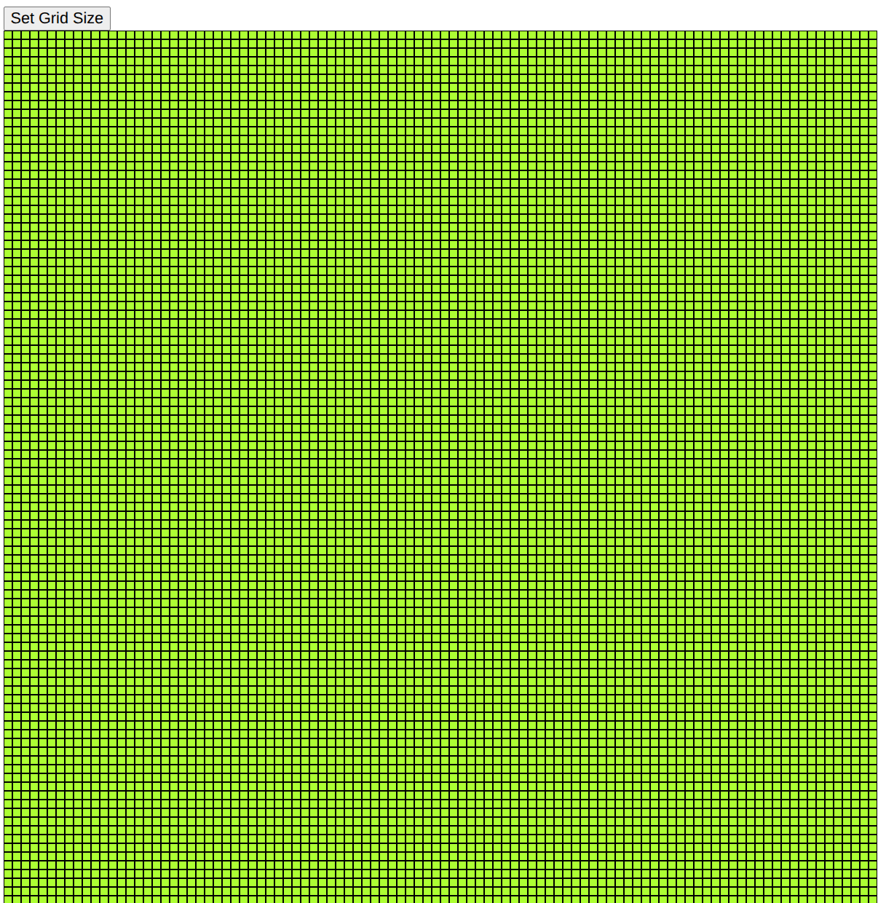
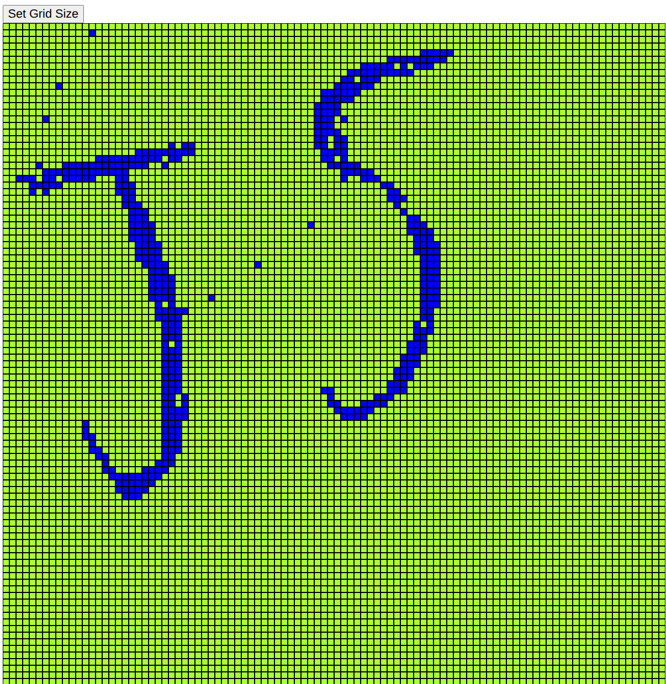

# Etch-a-Sketch

A browser-based drawing application inspired by the classic Etch-a-Sketch toy. Create pixel art by drawing on an interactive grid.

## Live Demo: [Etch A Sketch](https://amalk.au/etch-a-sketch/)

## Features

- Interactive drawing grid.
- Customisable grid size.
- Draw by hovering over grid cells.
- Clear the drawing board and start again.
- Simple and responsive user interface.





## Tech Stack

- HTML5
- CSS3
- JavaScript (ES6)

## Getting Started

1. Clone the repository:

   ```bash
   git clone https://github.com/amalk-au/etch-a-sketch.git
   ```

2. Navigate to the project directory:

   ```bash
   cd etch-a-sketch
   ```

3. Open `index.html` in your browser.

No additional dependencies or installation steps are required.

## Usage

1. Open the application in your browser.
2. Use the available controls to customise the grid.
3. Move your mouse over the grid cells to draw.
4. Clear the grid to start a new drawing.

## Project Structure

```text
etch-a-sketch/
├── index.html      # Main HTML structure
├── style.css       # Styling and layout
├── script.js       # Drawing functionality
├── LICENSE         # Project licence
└── README.md       # Project documentation
```

## License

This project is licensed under the GNU General Public License v3.0 (GPL-3.0). See the [LICENSE](LICENSE) file for details.

## Author : Amal K.

- GitHub: [@amalk-au](https://github.com/amalk-au)
- Portfolio: [amalk.au](https://amalk.au)
- Repository: [etch-a-sketch](https://github.com/amalk-au/etch-a-sketch)
